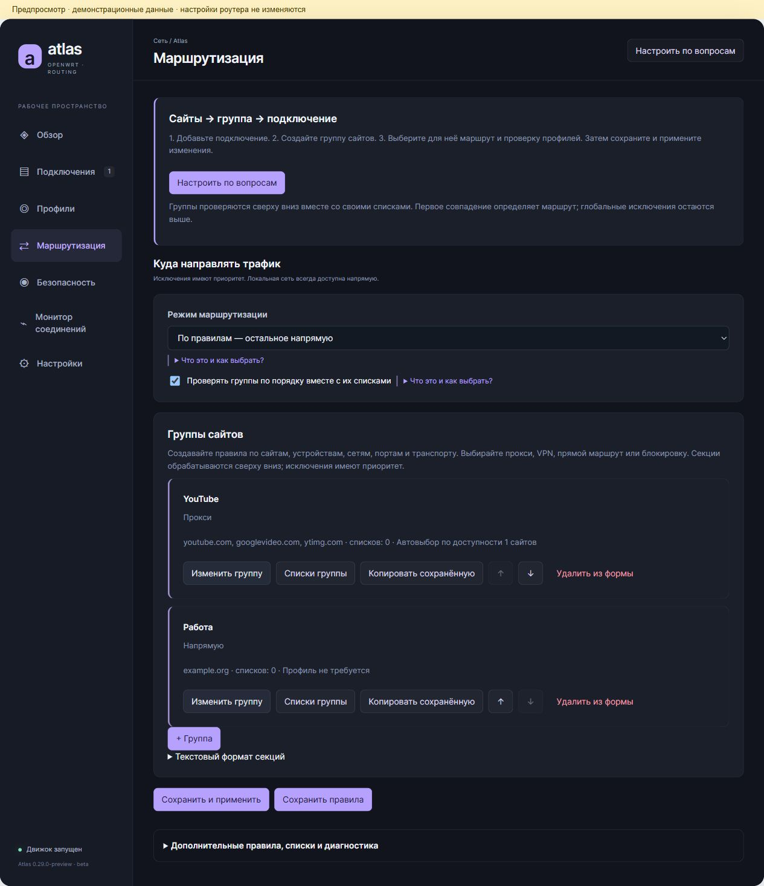

# Atlas 0.29.0 beta для OpenWrt

Группы сайтов вместо смешанного экрана правил, мастер из шести шагов, подбор профилей каждой группы по проверке нужной HTTPS-страницы и сравнение выхода браузера. Исправлена ошибка сохранения списков маршрутизации.

Установка или обновление в терминале роутера под root:

```sh
wget -O /tmp/atlas-install.sh https://raw.githubusercontent.com/Nissanstels1/Atlas/main/install.sh && sh /tmp/atlas-install.sh
```

Исправления после выпуска 0.29.0: панель серверов сохраняется при обновлении статуса, HTTPS-проверки учитывают FakeIP, добавлены кнопки блокировки рекламы и рекомендации защиты. Эти изменения уже есть в исходниках main; пакеты релиза 0.29.0 содержат исходную сборку. После её установки выполните:

```sh
wget -O /tmp/atlas-audit-repair.sh https://raw.githubusercontent.com/Nissanstels1/Atlas/main/atlas-openwrt/tools/repair-nanopi-audit.sh && sh /tmp/atlas-audit-repair.sh
```

Исправление проверяет контрольные суммы и не перезапускает маршрутизацию. После него обновите LuCI сочетанием Ctrl+F5.

Поддерживаются стабильные OpenWrt 24.10.1+ для ARM64/aarch64_generic, включая NanoPi R4SE, и x86_64. Установщик выбирает IPK/opkg либо APK/apk, проверяет SHA256 и устанавливает зависимости из feeds прошивки. APK не подписаны публичным ключом: bootstrap явно разрешает их после проверки SHA256. Atlas Engine r3 устанавливается отдельным пакетом рядом со штатным sing-box.

После обновления перезагрузите страницу LuCI с очисткой кеша (Ctrl+F5); затем откройте Atlas и мастер «Настроить по вопросам». Для сохранения без переключения маршрутизации есть отдельная кнопка. При применении маршруты меняются согласно настройкам.

Точечное исправление ошибки сохранения правил для прежнего выпуска:

```sh
wget -O /tmp/atlas-repair.sh https://raw.githubusercontent.com/Nissanstels1/Atlas/main/repair-list-save.sh && sh /tmp/atlas-repair.sh
```

[Пакеты 0.29.0](https://github.com/Nissanstels1/Atlas/releases/tag/v0.29.0-beta) · [Изменения и ограничения](atlas-openwrt/docs/release-0.29.0.md) · [Исходники](atlas-openwrt).

389 тестов на виртуальной OpenWrt: ошибок нет, один тест инструментов изменения образа диска пропущен. Проверены реальные HTTPS-запросы и обновление APK с сохранением настроек. Проверки IPv6 и внешнего DNS могут оставаться непроверенными. Гарантии полной анонимности и превосходства по скорости/RAM над Podkop нет.


